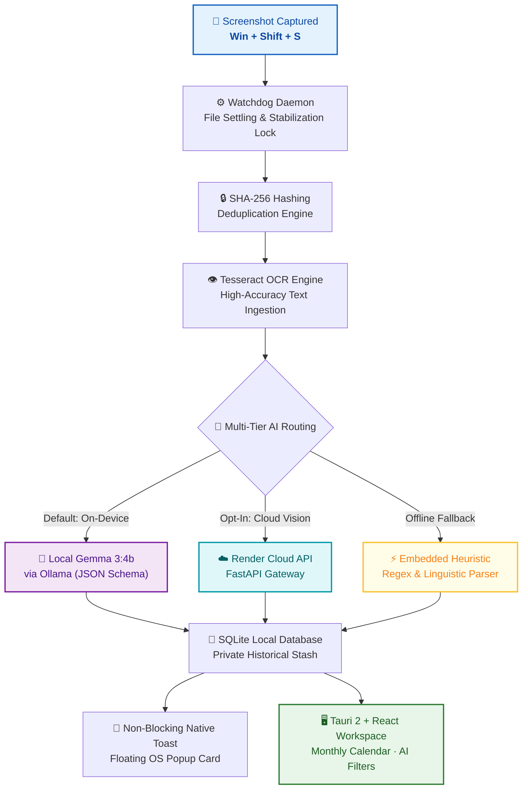

*This is a submission for the [Hacktoberfest Open-Source AI Challenge Week 3: Slow and Steady](https://dev.to/challenges/hacktoberfest-week3-2026-10-19)*

---

## What I Built

We all do it: we hit `Win + Shift + S` or `Cmd + Shift + 4` a dozen times a day.
- A meeting link dropped in Slack.
- An invoice or receipt after paying for coffee.
- A bug trace in a console log.
- An event invite on Twitter.
- A travel itinerary or flight confirmation.

And where do they go? **To die in `~/Pictures/Screenshots`**. Weeks later, you have 600 unorganized PNG files named `Screenshot (482).png`, and the tasks or meetings you captured are long forgotten.

**ScreenStash** solves this once and for all. It is a lightweight, privacy-first desktop workspace that quietly sits in the background, watches for new screenshots, debounces OS file locks, deduplicates via SHA-256, and immediately turns chaotic images into **actionable tasks, interactive calendar events, and categorized records** — completely on-device or via cloud runtime.

### Key Highlights:
- **Zero-Friction Ingestion**: Automatic background watcher daemon (`.pyw`) detects new screenshots with zero user intervention and triggers a floating OS toast notification.
- **On-Device Local Intelligence**: Powered by Google's open-weight **Gemma 3:4b** running locally via Ollama. Screenshots never leave your computer unless you explicitly choose to.
- **Production Cloud AI Runtime**: For users on low-power laptops without GPU/Ollama, ScreenStash seamlessly routes to a **Render**-hosted Cloud AI runtime for fast vision extraction.
- **Universal AI / LLM Semantic Filtering**: Every search query, smart collection (*"Needs attention"*, *"Saved for later"*), and filter is scored through an on-device multi-cluster semantic NLP engine with explanatory reasoning pills on each card.
- **Interactive Monthly Calendar**: A full 7-day grid (Mon–Sun) with multi-tier temporal extraction (mapping relative dates like *"next Tuesday"* or extracted event timestamps) and interactive, toggleable task checklists.
- **Native OS Integration**: Built with **Tauri 2 + Rust + React + TypeScript**, featuring floating hover popovers, full-screen lightbox previews, and native OS Explorer commands (`Show in Folder`).

---

## Demo

- **Repository**: [https://github.com/guptapiyush16/ScreenStash](https://github.com/guptapiyush16/ScreenStash)
- **Cloud API Runtime**: [https://screenstash-cloudapi.onrender.com](https://screenstash-cloudapi.onrender.com)
- **Live Landing Page**: [https://guptapiyush16.github.io/ScreenStash/](https://guptapiyush16.github.io/ScreenStash/)

### Visual Walkthrough:
1. **Interactive Monthly Calendar & Day Agenda**:
   Browse screenshots visually across dates. Clicking any date reveals scheduled meetings, flight times, and interactive task checklists you can strike through directly from the dashboard.
2. **Contextual Action Menus**:
   Clean three-dots menu on every card with direct OS actions: *View full screenshot*, *Show in folder* (opens Windows Explorer directly highlighting the file), *Copy summary*, *Copy OCR text*, *Search related*, and *Remove from stash*.
3. **Transparent AI Reasoning Pills**:
   Search for *"dinner expenses"* or *"zoom sync"*, and ScreenStash displays semantic match pills like `✦ AI: Semantic concept match (expense: "receipt") · Direct match in title` explaining exactly why the AI selected it.

---

## Code



The codebase is 100% open-source under the MIT license, structured into:
- `desktop/`: Tauri 2 desktop shell, React 19, TypeScript, and custom CSS design system.
- `desktop/src/aiFilter.ts`: Dual-tier semantic intent engine and Ollama JSON inference client.
- `desktop/src/Calendar.tsx`: Dynamic 7-day monthly calendar and temporal date extractor.
- `desktop/src-tauri/`: Rust backend implementing native IPC, asset protocols, file deletion, and OS shell commands.
- `cloud_service/`: FastAPI cloud runtime deployed on Render.
- `.github/workflows/`: Automated GitHub Actions release pipeline building Windows MSI and NSIS packages.

---

## How I Built It

ScreenStash was engineered with a privacy-first, layered architecture:

| Pipeline Stage | Technology | What Happens |
| :--- | :--- | :--- |
| **1. Capture & Debounce** | Win32 / Watchdog | Detects new screenshots, waits for file write lock to settle, and computes SHA-256 hash. |
| **2. Optical Ingestion** | Tesseract OCR | Reads raw text from image buffers without cloud network calls. |
| **3. AI Reasoning** | **Gemma 3:4b** / **Render** | Extracts structured titles, summaries, action checklists, and dates via strict JSON schemas. |
| **4. Sovereign Storage** | SQLite (`screenstash.db`) | Saves structured metadata locally in `%LOCALAPPDATA%\ScreenStash`. |
| **5. Desktop Presentation**| **Tauri 2 + React** | Renders interactive monthly calendar, hover popovers, and <2ms semantic intent search. |

### 1. Local Neural Inference with Google's Gemma 3
We chose **Gemma 3:4b** as our flagship on-device model. Using Ollama's structured JSON format, we pass the OCR extracted text into Gemma with strict schema constraints to reliably extract:
- Title & one-sentence summary
- Extracted categories (`Task`, `Event`, `Receipt`, `Reference`)
- Currency amounts (for expense tracking)
- Actionable todo checklists
- Explicit dates and relative temporal indicators

Because Gemma 3 is open-weight and runs locally, sensitive documents (bank statements, internal code snippets, credentials) **never leave the user's computer**.

### 2. Dual-Tier AI Filtering Pipeline
Running an LLM on every keystroke in a desktop search bar causes intolerable latency (300ms–1500ms) and token exhaustion. We solved this with a hybrid architecture:
- **Tier 1 (Instant <2ms)**: Real-time on-device semantic intent engine evaluating token n-grams and synonym clusters (`meeting`, `expense`, `urgent`, `task`, `doc`).
- **Tier 2 (Deep Neural LLM)**: On demand (<kbd>Enter</kbd> or clicking `✦ AI Filter`), queries local Ollama or Render Cloud with candidate items in strict JSON mode.
- **Smart Collections**: *"Needs attention"* uses `evaluateNeedsAttention()` to score urgency tokens (*"deadline"*, *"reschedule"*, *"conflict"*) and pending tasks; *"Saved for later"* uses `evaluateSavedForLater()` to detect reference documentation and expense archives.

### 3. Native Desktop WebView via Tauri 2 & Rust
Rather than packaging a bloated 250MB Electron binary, ScreenStash is built on Tauri 2:
- **Binary size**: <15MB.
- **RAM usage**: <60MB idle.
- **Secure Local Media**: Custom asset protocols (`convertFileSrc`) safely bridge local filesystem images into the webview without CSP violations.
- **Native OS Explorer**: Rust commands invoke `explorer.exe /select, <path>` to reveal the exact file in Windows Explorer with a single click.

---

## Why Does Open Innovation Matter?

Screenshots are among the most intimate and sensitive data artifacts on any computer:
- They contain API keys copied from dashboards.
- Financial receipts and credit card charges.
- Private Slack discussions, medical notes, and family flight tickets.

If ScreenStash were built as a closed-source, proprietary SaaS tool requiring all images to be uploaded to a remote server, **nobody conscious of privacy could responsibly use it**.

Open innovation—powered by open-weight models like **Google's Gemma**, open desktop frameworks like **Tauri**, and open-source models—makes a completely local, sovereign personal assistant possible:
1. **Verifiable Privacy**: Anyone can inspect our code to verify that screenshots remain on their device.
2. **Offline Independence**: The software works on an airplane or off the grid without an internet connection.
3. **No Vendor Lock-in**: If a proprietary cloud API changes pricing or shuts down, your desktop tool continues working forever with local models.

---

## My Agent Session

ScreenStash was designed, implemented, refactored, and tested with iterative pair-programming assistance:
- Documented architectural choices in **`Decisions.mc`** (logging 43+ technical decisions with rationales).
- Traced execution flows in **`Flow.md`** across 26 distinct architectural phases.
- Maintained a production-grade **`tech.md`** technical interview question & answer guide covering desktop sandboxing, concurrency, and semantic retrieval.

---

## The Lazy Payoff

Before ScreenStash:
- Spending 15 minutes scrolling through hundreds of chaotic screenshots trying to find that one meeting link or flight confirmation number.
- Forgetting to submit an expense report because the receipt screenshot was buried in `Downloads`.
- Missing follow-ups because task notes taken during a video call were captured in an image and forgotten.

With ScreenStash:
- **0 manual sorting effort**: You take a screenshot, and seconds later it's categorized, parsed into action items, and placed on your calendar.
- **Instant semantic recall**: Typing *"lunch with Alex"* or *"zoom link"* immediately surfaces the exact screenshot even if the word wasn't in the filename.
- **One-click action**: Copy OCR text or launch the file directly in Windows Explorer without hunting through folders.

---

## Prize Categories

### Featured Categories:

1. **Best Use of Render** ($200)
   - ScreenStash uses **Render** as its production cloud AI runtime:
     - Hosts the **ScreenStash Cloud API** (`https://screenstash-cloudapi.onrender.com`), a containerized FastAPI service with health checking, CORS management, and fallback execution.
     - Serves as the opt-in vision and inference gateway for users on resource-constrained devices who want instant AI processing without local GPU requirements.

2. **Best Use of Gemma** ($200)
   - ScreenStash uses **Gemma**, Google's open-weight model:
     - Leverages **Gemma 3:4b** via Ollama as the flagship on-device neural engine.
     - Executes structured JSON schema extraction (`/api/generate`) locally, parsing raw OCR screenshots into structured titles, summaries, todo checklists, and calendar dates with zero telemetry.

### Partner Categories:

3. **Best Use of GitHub Copilot & GitHub Actions** ($100)
   - Automated multi-platform desktop release pipeline (`.github/workflows/desktop-release.yml`).
   - Automatically builds Tauri 2 Windows MSI packages, NSIS standalone installers, and draft GitHub Releases triggered on semantic git tags (`v*`).

---

*Built with passion for Hacktoberfest 2026. Try it out, star the repo, and stop letting your screenshots go to waste!*
